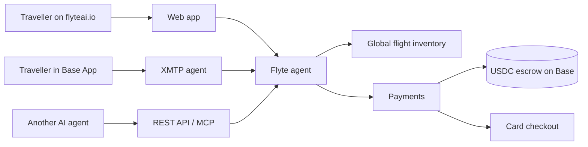

# Flyte AI

Book a real flight by talking to an AI agent, and pay in USDC on Base.

[flyteai.io](https://www.flyteai.io) · [API docs](https://www.flyteai.io/api-docs) · [X: @Flyte__AI](https://x.com/Flyte__AI)

> This repository holds Flyte's public documentation and architecture diagrams. The application source is private.

## What it does

You type a trip the way you'd text a friend: "Chicago to London, two weeks in November, nonstop." The agent works out what you mean, searches live airline inventory from 700+ airlines, and shows you the flight it would book with the times, stops and total price. You confirm, pay in USDC on Base (or by card), and the payment sits in escrow until the airline issues your ticket. If the booking fails, the escrow refunds you.

The same agent runs in three places:

| Surface | How you reach it |
|---|---|
| Web | Chat at [flyteai.io](https://www.flyteai.io) |
| Base App | Message the agent inside Coinbase's Base App over XMTP, or open Flyte as a mini app |
| Developers | Flight search over a REST API and an MCP server, so other AI agents can search fares |

## Status

| | |
|---|---|
| Live search | Yes. Real fares from live inventory, on the production site |
| Bookings | Proven end to end: a real ticket issued with a real airline booking reference |
| Paid production bookings | Waiting on funding the supplier's prepaid account. The code path is complete |
| Test mode | On the site today: search any route, and run a full test booking with a simulated payment on a set of test routes |

## How it works

- [Architecture](docs/architecture.md): the pieces and how a conversation turn flows
- [Booking flow](docs/booking-flow.md): search to ticket, and every check in between
- [Payments and escrow](docs/payments.md): USDC on Base, refunds, and the safety rules money follows
- [API and MCP](docs/api.md): search flights from your own agent

## Onchain

| | Address (Base mainnet) |
|---|---|
| Escrow wallet | [`0xc93398C91FE522bf45DB14Bd30098A7869c4a294`](https://basescan.org/address/0xc93398C91FE522bf45DB14Bd30098A7869c4a294) |
| $FLYTE token | [`0x34c4a0056faD621C723433A473140Aadc8998A8b`](https://basescan.org/token/0x34c4a0056faD621C723433A473140Aadc8998A8b) |
| XMTP agent | `0x6af597a4b53d6a7fdb373b416c753053ebcd32a0` |
| Base Builder Code | `bc_onecl86r` (ERC-8021 attribution on every payment) |

## Company

Flyte Technologies Inc, a Delaware corporation based in Oswego, Illinois. Contact: team@flyteai.io

Docs in this repository are licensed under [CC BY 4.0](LICENSE).
