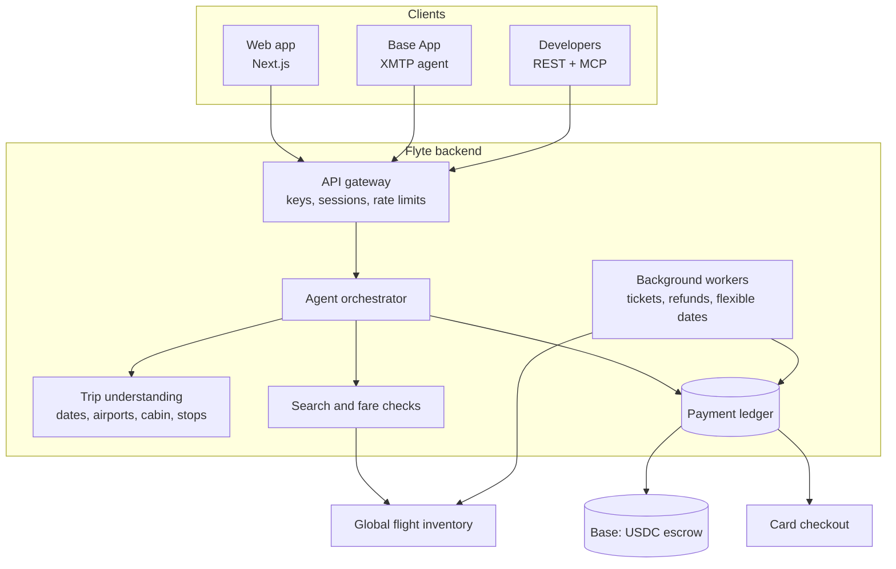
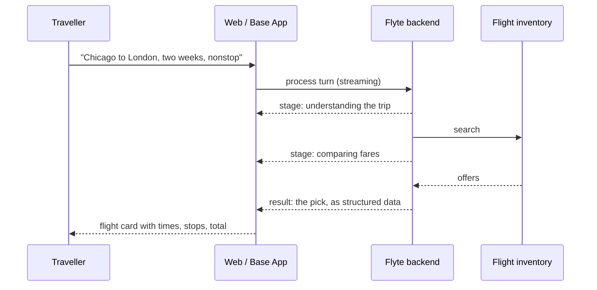

# Architecture

Flyte is one booking agent behind three front doors. Every surface talks to the same backend, so a search on the web, in the Base App, or over the API runs the same code and follows the same rules.

## A conversation turn

A long flight search can take a minute or more, so the agent streams its progress instead of making you stare at a spinner.

What comes back is structured data, not prose. The flight card is drawn from the supplier's own numbers, so a price the traveller pays against is never something a language model wrote.

## Design rules

- **One agent, every surface.** Web, Base App and API share one orchestrator and one set of checks.
- **Prices come from data, not from the model.** The model understands the request; the fare, the total and the times come from the supplier's response.
- **Conversations persist, searches do not.** A conversation can be resumed later. Search results expire with the supplier session, so a resumed trip searches again instead of offering a stale fare.
- **Test and live are fully separate.** Test mode runs on its own backend, its own data, its own escrow and a test inventory account. A startup check refuses to run if test mode could reach live money or live inventory.
