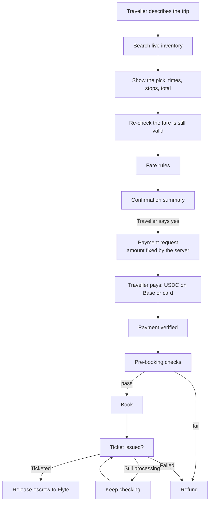

# Booking flow

From "I want to go to London" to an issued ticket.

## The checks, and why each exists

| Check | What it stops |
|---|---|
| Fare re-check before payment | Charging for a fare that has already gone |
| Price rise needs a new yes | A fare that moved after you agreed being charged anyway. A large jump is refused outright |
| Amount fixed when the payment request opens | A client sending a different amount than the one you agreed to |
| Only the agreed fare can be booked | Booking a different flight than the one you paid for |
| Consent recorded only at the "yes" | Treating anything other than an explicit yes as agreement |
| Pre-booking validation | Name format, passport validity and similar problems that would otherwise surface at the airport |
| "Could not confirm" means stop | A missing answer from the supplier never falls back to a guess |

## Ticketing

A booking is only finished when the airline has issued the ticket. Until then the payment stays in escrow. A booking that is still processing is checked again by a background worker rather than being treated as a failure, because refunding a fare while the airline is still issuing the ticket would leave the traveller with a ticket and their money back.
