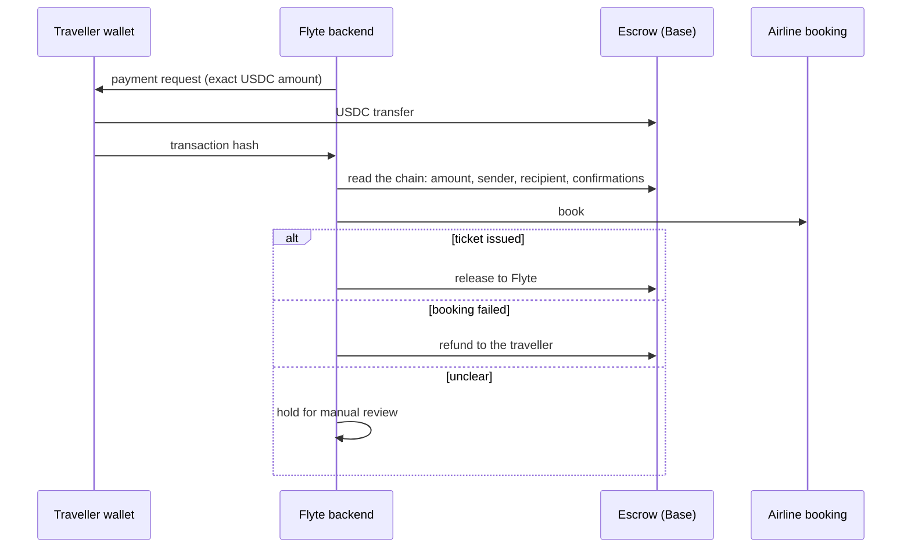

# Payments and escrow

Flyte takes payment in USDC on Base, or by card. Crypto payments go into an escrow wallet and stay there until the airline issues the ticket.

## USDC on Base

The escrow is a server wallet on Base held through Coinbase Developer Platform: [`0xc93398C91FE522bf45DB14Bd30098A7869c4a294`](https://basescan.org/address/0xc93398C91FE522bf45DB14Bd30098A7869c4a294). It is not a smart contract; release and refund are decided by the backend under the rules below and are visible onchain.

Every payment transaction carries Flyte's Base Builder Code (`bc_onecl86r`, ERC-8021), so Flyte's onchain activity is attributed to it.

## The rules money follows

| Rule | Why |
|---|---|
| The amount comes from the server's record, never from the client | Nobody can pay less than the fare by editing a request |
| Verification reads the chain: the USDC Transfer to the escrow, from the bound payer, for the recorded amount | A transaction hash alone proves nothing |
| One payment per booking, across every rail | A trip cannot be paid twice, in crypto and by card |
| A transaction hash can be claimed once | The same payment cannot fund two bookings |
| Money is never a float | Rounding errors on money are bugs, so amounts stay exact |
| Once the transfer is broadcast, nothing after it can report "failed" | A failure triggers a retry, and a retry of a completed transfer sends money twice |
| Ticketed means hold, never refund | If a ticket exists and something else goes wrong, a person reviews it instead of refunding automatically |
| Refunds are retried by a worker and reconciled against the chain | A refund that was sent but not recorded is found, not sent again |

## Card

Card payments go through a hosted checkout. The browser never handles card details or sets the amount. A card payment is confirmed only by a signature-verified webhook, and it shares the same payment ledger as crypto, so the one-payment-per-booking rule holds across both.

## Solana (in development)

A Solana USDC rail for Flyana, Flyte's Solana storefront, is built on the same ledger and rules and is switched off until it is launched.
